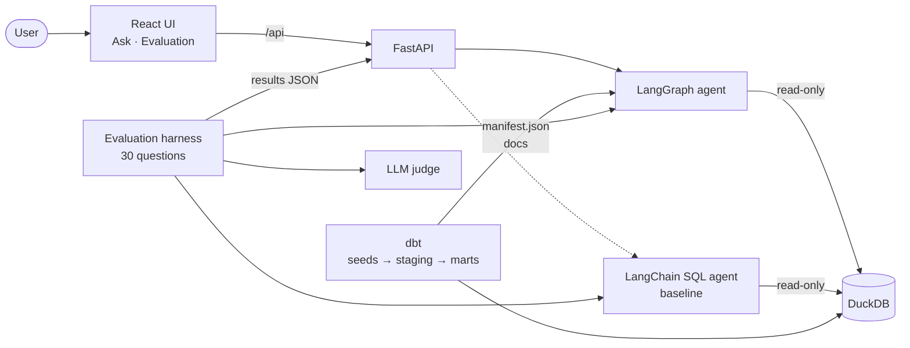
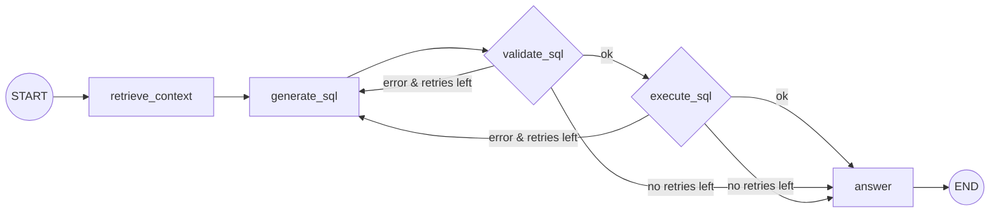

<div align="center">
# 🧠 AI Data Analyst Agent
 
**Ask business questions in plain English, get SQL-backed answers, and know exactly when and why the agent is wrong.**
 
A Text-to-SQL agent built with **LangGraph** on top of **dbt** models, with a full **evaluation harness**
(execution accuracy · hallucinated-number detection · LLM-as-a-judge) and an **ablation study** measuring
how much dbt documentation in the context improves accuracy.
 


 
</div>
---
 
## 📌 Table of contents
 
- [Why this project](#-why-this-project)
- [Demo](#-demo)
- [Features](#-features)
- [Architecture](#-architecture)
- [The agent (LangGraph)](#-the-agent-langgraph)
- [Data & dbt models](#-data--dbt-models)
- [Evaluation methodology](#-evaluation-methodology)

- [Getting started](#-getting-started)
- [Project structure](#-project-structure)
- [Tech stack](#-tech-stack)
- [Roadmap](#-roadmap)
- [Author](#-author)
---
 
## 🎯 Why this project
 
Text-to-SQL demos look impressive, but in production the real problem is **silent failure**: a query
that runs fine but forgets a filter, joins the wrong table, or an answer that states a number that
was never in the result.
 
This project treats the agent as a system to be **measured**, not just demoed:
 
1. **Build** a controllable agent that writes, validates, self-corrects and executes SQL over dbt models.
2. **Evaluate** it on an annotated test set to find *where* it fails (wrong joins, wrong filters, hallucinated numbers…).
3. **Quantify** how much the business context written in dbt documentation improves accuracy.
---
 
## 🎬 Demo
 
<!-- Add your screenshots to docs/ and keep these paths -->
| Ask page | Evaluation dashboard |
|---|---|
|  |  |
 
**Example**
 
> **Q:** *Show revenue by customer country, from highest to lowest.*
>
> **A:** Revenue by customer country from highest to lowest: Italy 47,204.4, Tunisia 28,254.3, Germany 24,385.1, Belgium 23,235.4, France 21,754.3, Spain 19,739.4.
 
```sql
SELECT c.country, ROUND(SUM(o.net_amount), 2) AS revenue
FROM fct_orders o
JOIN dim_customers c ON o.customer_id = c.customer_id
WHERE o.status = 'completed'
GROUP BY c.country
ORDER BY revenue DESC
```
 
---
 
## ✨ Features
 
| | |
|---|---|
| 🔀 **Explicit LangGraph pipeline** | Context → SQL generation → validation → execution → grounded answer, with traceable steps |
| 🛡️ **SQL guardrails** | `sqlglot` parsing, read-only enforcement, table allow-list, DuckDB `EXPLAIN` before execution |
| 🔁 **Self-correction loop** | Validation or runtime errors are fed back to the LLM (configurable retries) |
| 📚 **dbt docs as context** | Model & column descriptions parsed from `manifest.json` carry the business rules |
| 🧪 **30-question test set** | Gold SQL + difficulty tags (joins, filters, ratios, time, unanswerable…) |
| 📏 **3 complementary metrics** | Execution accuracy, deterministic number-grounding check, LLM-as-a-judge root cause |
| 🔬 **Ablation study** | 4 context levels compared, plus a LangChain ReAct SQL agent baseline |
| 🖥️ **Web interface** | Chat with SQL, table, auto-chart and agent trace; evaluation dashboard with heatmap by tag |
| 🔌 **Model-agnostic** | Groq, OpenAI, Anthropic, xAI or local models via Ollama (`provider:model` in `.env`) |
 
---
 
## 🏗️ Architecture
 

 
---
 
## 🤖 The agent (LangGraph)
 

 
| Node | What it does |
|---|---|
| `retrieve_context` | Builds the database context according to the selected **context mode** |
| `generate_sql` | The LLM writes one DuckDB `SELECT`; on retry it receives its previous SQL and the error |
| `validate_sql` | `sqlglot` parse · blocks DDL/DML · checks tables against an allow-list · DuckDB `EXPLAIN` |
| `execute_sql` | Runs the query with a row cap; errors are routed back to `generate_sql` |
| `answer` | Phrases the answer **using only numbers present in the result**; says so when there is no data |
 
Each node appends an entry to `state["trace"]` (timing, SQL, errors), so every failure can be traced
back to a precise step. The trace is visible in the UI.
 
**Why LangGraph rather than a single ReAct agent?** A ReAct agent decides its own tool calls and is a black box.
An explicit graph makes the behaviour reproducible, debuggable and measurable step by step, which the
evaluation needs. The ReAct agent is kept as a **baseline** for comparison.
 
---
 
## 🗃️ Data & dbt models
 
Synthetic, deterministic e-commerce data (`scripts/generate_seed_data.py`, fixed seed): 200 customers,
15 products in 4 categories, ~500 orders over 2024–2025 (completed / returned / cancelled),
~1,300 order lines and payments.
 
```
seeds (raw CSV)  →  staging (rename, cast)  →  marts (analysis-ready)
```
 
| Mart | Grain | Content |
|---|---|---|
| `fct_orders` | one row per order | status, gross/net amount, payment method, `order_month`, `order_year` |
| `fct_order_items` | one row per order line | product, category, quantity, discount, net amount, margin |
| `dim_customers` | one row per customer | country, segment, pre-aggregated lifetime metrics |
| `dim_products` | one row per product | price, cost, lifetime units, revenue, margin |
 
`schema.yml` documents every model and column, including **business rules that cannot be inferred from
the schema**, for example:
 
- *Revenue = `SUM(net_amount)` over `status = 'completed'` only; cancelled and returned orders are never revenue.*
- *`is_repeat_customer` = at least 2 completed orders.*
- *`amount_paid` is 0 for cancelled orders; do not use it for revenue.*
It also declares data tests (`unique`, `not_null`, `accepted_values`) executed by `dbt build`.
 
---
 
## 🧪 Evaluation methodology
 
### Test set: `eval/questions.yaml`
 
30 business questions, each with a **gold SQL** query and **difficulty tags**:
 
| Tag | Tests whether the agent… |
|---|---|
| `revenue_filter` | applies the "completed orders only" business rule |
| `join` | joins marts on the right keys |
| `time` | filters/groups by year, month, quarter |
| `ranking` | uses `ORDER BY … LIMIT` correctly |
| `ratio` | computes percentages/rates correctly |
| `null_handling` | handles customers without orders, NULL payments |
| `definition` | uses columns whose meaning is only in the docs |
| `multi_step` | needs CTEs or several aggregation levels |
| `unanswerable` | **refuses to invent a number** when the data does not exist |
 
### Metrics
 
| Metric | How | Detects |
|---|---|---|
| **Execution accuracy** | Predicted vs gold result sets (`eval/compare.py`): tolerant to aliases, row order (unless ordering matters), float rounding and extra columns | Wrong SQL logic |
| **Number grounding** | Deterministic check that every number in the final answer appears in the SQL result (`eval/judge.py`) | **Hallucinated numbers** |
| **LLM-as-a-judge** | A stronger, different model compares agent vs gold SQL/result and labels the root cause | `wrong_filter`, `wrong_join`, `wrong_aggregation`, `wrong_column`, `wrong_time_range`, `sql_error`, `hallucinated_number`, `no_answer` |
 
### Ablation: what goes into the context
 
| Config | Context given to the LLM |
|---|---|
| `tables_only` | table names |
| `schema` | + columns and types |
| `schema_docs` | + dbt model and column descriptions |
| `schema_docs_examples` | + 4 few-shot question/SQL pairs (**no overlap** with the test set) |
| `baseline` | LangChain `create_sql_agent` (ReAct) |
 
---

## 🚀 Getting started
 
### Prerequisites
 
- Python 3.10+
- Node.js 18+
- An LLM API key (e.g. a free [Groq](https://console.groq.com) key) or a local model with [Ollama](https://ollama.com)
### 1. Install
 
<details open>
<summary><b>Windows (PowerShell)</b></summary>
```powershell
python -m venv .venv
.venv\Scripts\Activate.ps1
pip install -r backend\requirements.txt
pip install langchain-groq          # if you use Groq
cd frontend; npm install; cd ..
```
If script execution is blocked: `Set-ExecutionPolicy -Scope CurrentUser RemoteSigned`
</details>
<details>
<summary><b>macOS / Linux</b></summary>
```bash
python -m venv .venv && source .venv/bin/activate
pip install -r backend/requirements.txt
pip install langchain-groq
cd frontend && npm install && cd ..
```
</details>
### 2. Configure the LLM
 
Copy `.env.example` to `.env` and set your models and key:
 
```env
# format: provider:model (LangChain init_chat_model)
AGENT_MODEL=groq:openai/gpt-oss-20b
JUDGE_MODEL=groq:openai/gpt-oss-120b
GROQ_API_KEY=gsk_...
MAX_SQL_RETRIES=2
```
 
Other providers: `openai:gpt-4o-mini`, `anthropic:<model>`, `xai:<model>`, `ollama:qwen2.5-coder:7b`.
Model names change often; check your provider's model list.
 
### 3. Build the warehouse with dbt
 
```bash
cd dbt_project
dbt build --profiles-dir .          # seeds + models + tests -> data/warehouse.duckdb
dbt docs generate --profiles-dir .  # manifest.json used as agent context
cd ..
python scripts/validate_gold_sql.py # expect: 30/30 gold queries OK
```
 
### 4. Run the app
 
```bash
# terminal 1 — API on http://localhost:8000
cd backend
uvicorn app.main:app --reload --port 8000
 
# terminal 2 — UI on http://localhost:5173
cd frontend
npm run dev
```
 
### 5. Run the evaluation
 
```bash
# quick smoke test (5 questions, one config, no judge)
python -m eval.run_eval --modes schema_docs --no-baseline --limit 5 --no-judge
 
# full run: 4 context modes + baseline, with LLM judge
python -m eval.run_eval
```
 
> On macOS/Linux, a `Makefile` provides shortcuts: `make install`, `make dbt`, `make check`, `make api`, `make front`, `make eval`.
 
---
 
## 📁 Project structure
 
```
ai-data-analyst-agent/
├── backend/
│   ├── app/
│   │   ├── agent/
│   │   │   ├── graph.py          # LangGraph pipeline: nodes, routing, self-correction
│   │   │   ├── baseline.py       # LangChain create_sql_agent baseline
│   │   │   ├── context.py        # 4 context modes, dbt manifest parsing
│   │   │   ├── prompts.py        # SQL generation & answer prompts
│   │   │   └── examples.yaml     # few-shot examples (disjoint from test set)
│   │   ├── config.py · db.py · llm.py
│   │   └── main.py               # FastAPI endpoints
│   └── requirements.txt
├── dbt_project/
│   ├── seeds/                    # raw CSVs
│   ├── models/staging/           # cleaning layer
│   ├── models/marts/             # fct_* / dim_* + schema.yml (docs & tests)
│   └── dbt_project.yml · profiles.yml
├── eval/
│   ├── questions.yaml            # 30 questions, gold SQL, tags
│   ├── compare.py                # execution accuracy
│   ├── judge.py                  # number grounding + LLM-as-a-judge
│   ├── run_eval.py               # evaluation runner
│   └── results/                  # run outputs (JSON)
├── frontend/                     # React + Vite + Recharts
├── scripts/                      # seed data generator, gold SQL validator
└── .env.example
```
 
### API endpoints
 
| Method | Route | Description |
|---|---|---|
| `GET` | `/api/health` | API and warehouse status |
| `GET` | `/api/config` | Available context modes and agents |
| `POST` | `/api/ask` | `{question, context_mode, agent}` → SQL, result, answer, trace |
| `GET` | `/api/eval/runs` | List evaluation runs |
| `GET` | `/api/eval/runs/{id}` | Full results of a run |
 
---
 
## 🧰 Tech stack
 
| Layer | Tools |
|---|---|
| Agent | LangGraph, LangChain, Groq / OpenAI / Ollama |
| SQL safety | sqlglot, DuckDB `EXPLAIN`, read-only connection |
| Data | dbt (dbt-duckdb), DuckDB |
| Evaluation | Execution accuracy, deterministic grounding check, LLM-as-a-judge (structured output with Pydantic) |
| Backend | FastAPI, Pydantic, Uvicorn |
| Frontend | React, Vite, Recharts |
 
---
 
## 🗺️ Roadmap
 
- [ ] Schema retrieval (embeddings over column docs, top-k) to scale beyond a handful of marts
- [ ] dbt Semantic Layer / MetricFlow metrics exposed as tools instead of raw SQL
- [ ] LangSmith tracing
- [ ] CI job that fails when execution accuracy drops below a threshold
- [ ] Larger and harder test set (window functions, cohort analysis)
---
 
## 👩‍💻 Author
 
**Salma Ben Chaouacha**, Software Engineering student (AI engineering & data)
 
[](https://www.linkedin.com/in/salma-ben-chaouacha-4a5425343/)
[](https://github.com/salmabenchaouacha)
[](https://portfoliosalmabenchaouacha.vercel.app/)
 